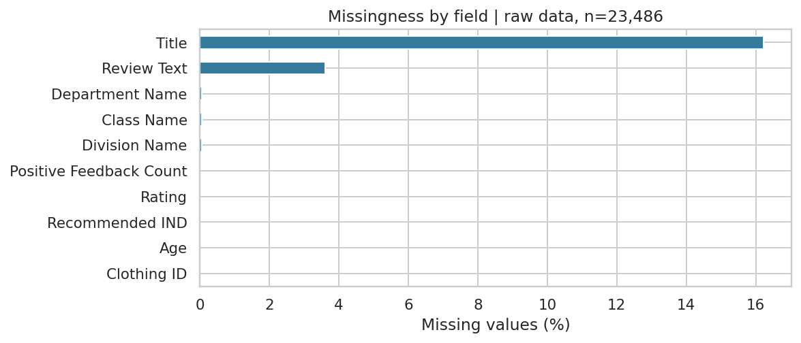
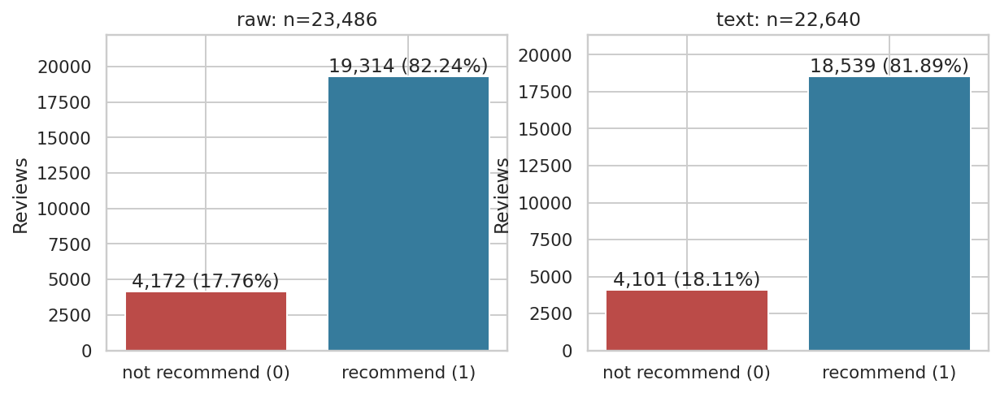
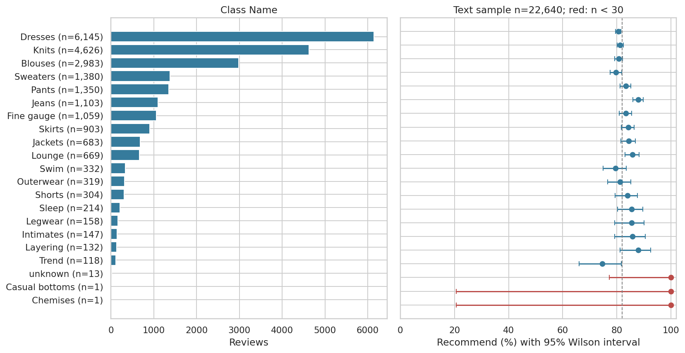
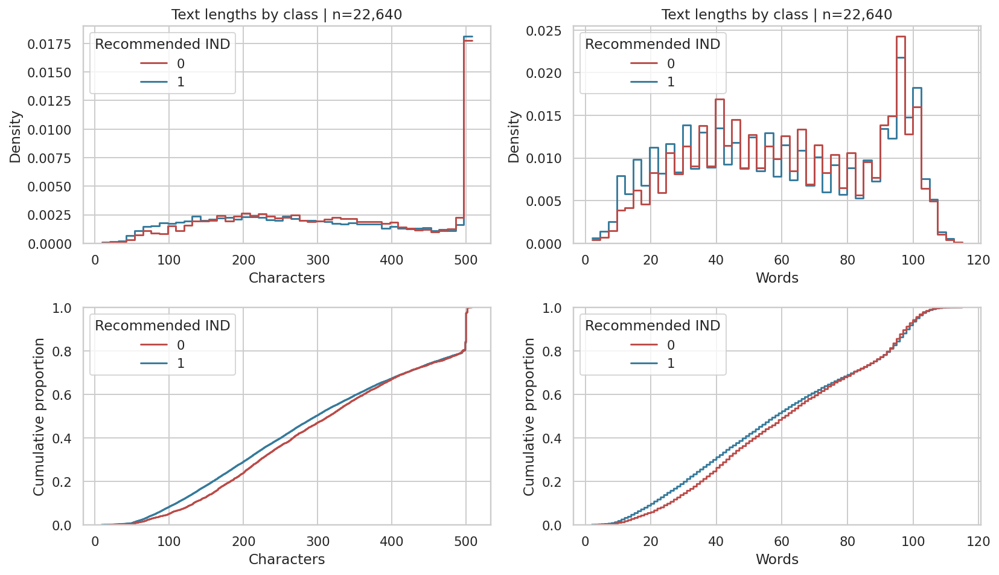
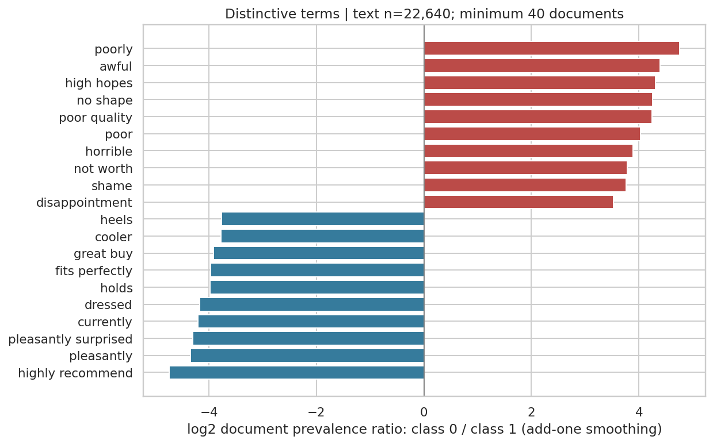
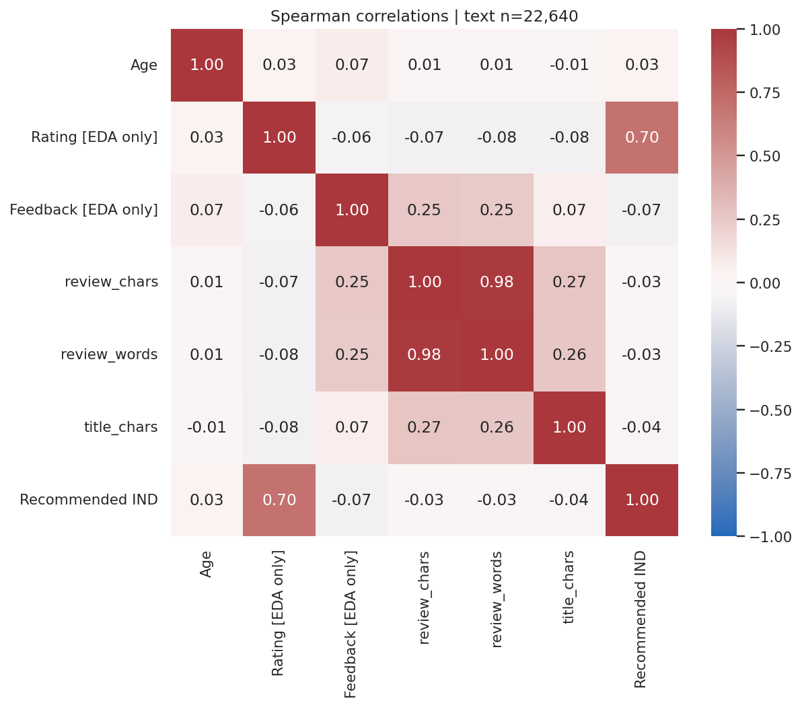

# Review Decoder — результаты чекпоинта 2

## Постановка и воспроизводимость

Бинарная классификация английского отзыва: `Recommended IND = 1` — рекомендация, `0` — её отсутствие. Результат проекта должен описывать вероятность рекомендации покупательницей, а не объективное качество товара или универсальную тональность текста.

[Источник и схема данных](../docs/dataset.md) · [Выполненный ноутбук](../notebooks/01_eda.ipynb) · [Машиночитаемая сводка](tables/summary.json).

Исходный файл: 23,486 строк, 10 содержательных полей и индекс экспорта. Контрольная сумма SHA-256: `bd93cc515747ad1f87b8bc863c9e40da758509e6db6506a96d06976e61e36ee0`. Python 3.10.4, pandas 2.2.3, scikit-learn 1.6.1, seed 42. Команда из корня: `.venv/Scripts/python.exe scripts/run_eda.py`. Ноутбук и этот отчёт восстанавливаются из CSV; окружение, исходник и локальные манифесты исключены из Git.

EDA использует весь датасет. Тестовая часть для моделей здесь не выделяется, и будущий test из этих данных нельзя называть полностью неизученным. Подбор признаков и моделей далее должен выполняться внутри train; одинаковые тексты не должны попадать в разные части разбиения.

## Качество данных и подготовка

В исходной таблице отсутствуют 3,810 заголовков (16.22%), 845 основных текстов (3.60%) и по 14 значений каждого уровня категории (0,06%). Пропусков в остальных полях не обнаружено. Общая доля пустых ячеек без индекса — 2.00%; неполных строк — 3,824 (16.28%). Подробности: [таблица пропусков](tables/missing_values.csv), [сочетания](tables/missing_patterns.csv).

Текст отсутствует у 1.70% класса 0 и 4.01% класса 1. χ² даёт p≈4,12×10⁻¹³, но Cramér's V≈0,047 показывает небольшой эффект. Для заголовка V≈0,024. Поэтому пропуски связаны с таргетом, но причина не установлена. Гипотеза об оценке без текста совместима с данными; доказать механизм сбора по CSV нельзя. Лишь одна строка без основного текста имеет заголовок, поэтому заголовок не восстановит большинство пустых отзывов. [Проверка гипотез](tables/missingness_hypotheses.csv).

Ошибок по проверенным доменам не найдено: таргет 0/1, рейтинг 1–5, возраст 18–99, идентификаторы неотрицательные целые, отклики 0–122. [Проверки](tables/domain_checks.csv) не доказывают отсутствие любых ошибок: семантическую корректность каждого текста и возраста по CSV установить нельзя.

Обнаружен 21 полный повтор без индекса экспорта; только один относится к непустому отзыву. В сыром наборе шесть групп совпадающего нормализованного текста без конфликтующих меток. Полное совпадение всех полей рассматривается как кандидат на повторный экспорт: удаление одного повтора — явное допущение, а не доказанная история происхождения. Совпадения текста при различающихся полях сохранены.

| Этап | Строк | Исключено | Рекомендаций, % |
| --- | --- | --- | --- |
| raw | 23,486 | 0 | 82.24 |
| nonempty_review | 22,641 | 845 | 81.89 |
| exact_duplicate_removed | 22,640 | 1 | 81.89 |

У строк без текста сохраняется место в аудите, но они исключены из text-only выборки. Отсутствующий заголовок заменён пустой строкой, категория — `unknown`; исходные пропуски сохранены отдельными флагами. Оставлена исходная метка `Initmates`. Исходный CSV не изменён; числовой импутации и обрезки не применялось. [Журнал обработки](tables/cleaning_ledger.csv).

## Баланс классов

До обработки: 19,314 рекомендаций (82,24%) и 4,172 нерекомендаций (17,76%). После обработки: 18,539 рекомендаций (81.89%) и 4,101 нерекомендация (18.11%). Постоянный ответ класса большинства даст высокую accuracy, не распознавая класс 0. Это ориентир дисбаланса, а не оценка обученной модели на тесте.

Основная метрика будущих экспериментов — Macro-F1, дополнительно F1 класса 0 и PR-AUC с положительным классом `not recommend`: `y_negative = (y == 0)`, вероятность класса 0. Также ROC-AUC с явно указанным классом и confusion matrix. Ресэмплинг в EDA не применялся.

## Числовые признаки и выбросы

IQR-фильтр отметил бы 108 возрастов выше 79 лет, 2 147 больших значений откликов и 2 370 рейтингов 1–2. Низкие оценки оказываются «выбросами» из-за преобладания оценок 4–5; их удаление исказило бы задачу. Крайние значения возраста и откликов допустимы по домену; после просмотра примеров они сохранены. Большие отклики отображаются через `log1p` только на графике. [Кандидаты по IQR](tables/outlier_candidates.csv).

Встречаются 296 случаев рейтинга 1–2 с рекомендацией или рейтинга 4–5 без неё. Оценка и рекомендация связаны, но не тождественны: заменять метку по рейтингу нельзя. Spearman с таргетом для рейтинга — 0.696, возраста — 0.035, откликов — -0.075. Сильная связь рейтинга не отменяет запрет использовать его в основной модели.

`Clothing ID` описывает товар, а не упорядоченную величину. В сыром наборе 1,206 товаров; на 10 самых обсуждаемых приходится 25.17% отзывов. Концентрация может влиять на оценку переноса на новые товары; идентификатор допустим для диагностического группирования, но не как вход основной модели.

## Категории одежды

| Отдел | n | Рекомендаций, % | Wilson 95%, % |
| --- | --- | --- | --- |
| Tops | 10,048 | 81.07 | 80.29–81.82 |
| Dresses | 6,145 | 80.52 | 79.51–81.49 |
| Bottoms | 3,661 | 84.95 | 83.75–86.07 |
| Intimate | 1,653 | 84.63 | 82.82–86.29 |
| Jackets | 1,002 | 83.33 | 80.90–85.51 |
| Trend | 118 | 74.58 | 66.03–81.57 |
| unknown | 13 | 100.00 | 77.19–100.00 |

Разница между отделами даёт основание проверить «текст + категория» в следующих экспериментах. Это пока не доказательство выигрыша модели. В текстовой выборке у `Casual bottoms` и `Chemises` по одному примеру, у `unknown` — 13. Доля 100% там сопровождается широким интервалом и не означает надёжного преимущества категории. Интервалы Wilson описательные и предполагают независимость наблюдений; общие товары и авторы могут нарушать это предположение.

## Длины, короткие и неоднозначные отзывы

Медиана основного текста у класса 0 — 61 слово / 316 символов, у класса 1 — 58 слов / 298 символов. Распределения значительно перекрываются; Spearman длины в словах с таргетом всего -0.029. По одной длине нельзя судить о рекомендации конкретного отзыва. [Квантили](tables/length_quantiles.csv).

| Максимум слов | n | Класс 0, n | Класс 0, % |
| --- | --- | --- | --- |
| 3 | 18 | 2 | 11.11 |
| 5 | 52 | 5 | 9.62 |
| 10 | 357 | 37 | 10.36 |

Порог 5 слов предварительный: таких отзывов только 52, нерекомендаций — пять. Это маленькая группа; короткие тексты могут быть содержательными и сохраняются. Заголовки часто добавляют контекст, поэтому «заголовок + текст» остаётся отдельным экспериментом.

Ровно 500 символов имеют 3,061 отзывов (13.52%), максимум — 508. Накопление около 500 и окончания некоторых текстов совместимы с ограничением источника, но без описания сбора усечение не доказано. Максимальный ввод сервиса не должен автоматически равняться 500.

В ноутбуке рассмотрены низкие/высокие оценки с неожиданной рекомендацией, короткие отзывы и тексты с `love/great/beautiful` вместе с `but/however/although`. Последние — иллюстративная выборка смешанных мнений, а не валидированная разметка сложности.

## Слова, биграммы и отрицания

Частоты нормированы по числу документов класса; единичные токены отсечены `min_df=10`. Отрицания `no/not/nor` сохранены; отрицательные сокращения развёрнуты. Биграммы строятся по соседним токенам без склейки через удалённые стоп-слова. Матрица частот разреженная, её обучение на всём наборе относится только к EDA; будущий TF-IDF обучается заново внутри train.

`not` есть в 65.7% класса 0 и 48.1% класса 1: само присутствие отрицания не определяет метку. `poor quality`, `not worth`, `awful` чаще связаны с нерекомендацией; `highly recommend`, `fits perfectly`, `pleasantly surprised` — с рекомендацией. Среди положительных ассоциаций встречаются слова вроде `heels`: это также состав ассортимента, а не только тональность. Отношение частот не является причинным эффектом или важностью обученной модели.

## Попарные связи

Pairplot построен на стратифицированной подвыборке 2,500 строк с seed 42, а корреляции Spearman — на всех 22,640 текстовых строках. Числовой код товара и индекс не включены; категории не превращались в произвольные числовые коды. Длины в символах и словах сильно связаны, а связь длины с таргетом слаба. [Корреляции](tables/spearman_correlations.csv), [pairplot](figures/10_pairplot.png).

## Решения для следующих этапов и ограничения

1. Использовать 22,640 непустых отзывов после явного удаления одного полного повтора; сохранять исходные идентификаторы и текстовые группы. В будущем зафиксировать разбиение с учётом групп и дисбаланса до обучения pipeline.
2. Обучить `DummyClassifier`, затем `TF-IDF + LogisticRegression`; отдельно сравнить текст с текстом + категорией. Рейтинг, отклики и ID товара запрещены основной модели; возраст не входит в запланированный сервис.
3. Проверить n-граммы, отрицания, объединение заголовка и текста, качество по длинам и редким категориям. Пропуск заголовка не должен удалять строку, пропуск категории должен поддерживаться через unknown.
4. Для сервиса отклонять пустой/пробельный ввод, поддерживать отсутствие категории и проверять ограничения длины на реальном pipeline. Вероятности должны исходить из вероятностной модели либо калибровки; одна статистика EDA их не даёт.
5. Учитывать данные одного англоязычного магазина, концентрацию на товарах, отсутствие временных меток и идентификаторов авторов. Перенос на другие языки, магазины и периоды не проверен. Причины пропусков и возможное усечение остаются гипотезами.

Подробная связь «наблюдение → доказательство → действие» сохранена в [таблице выводов](tables/conclusions.csv). Обучение моделей, измерение их качества и сервис в этот чекпоинт не входят.
